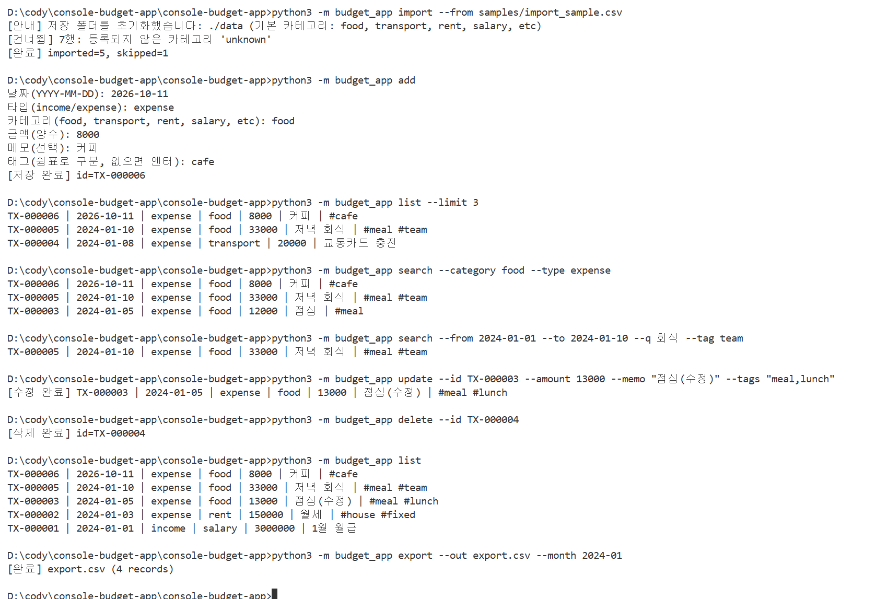
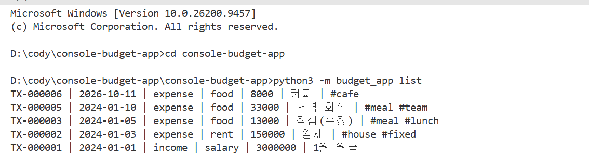
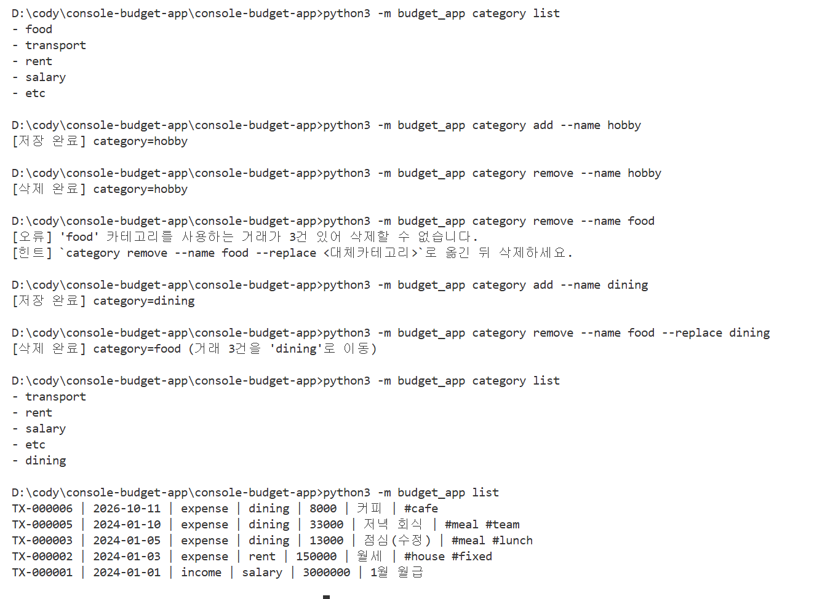
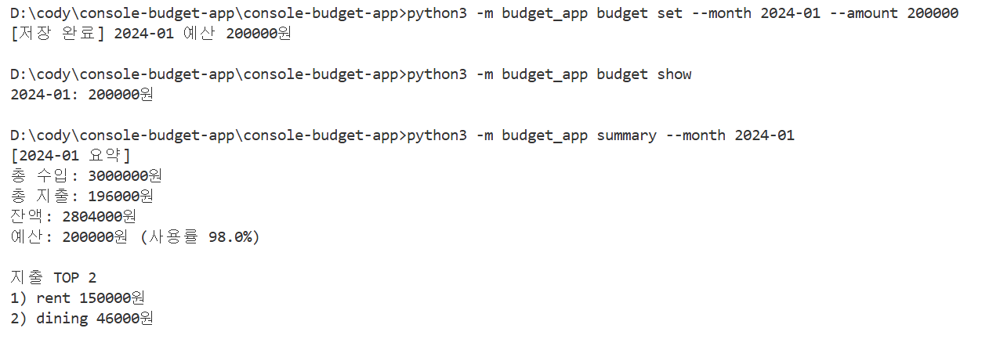
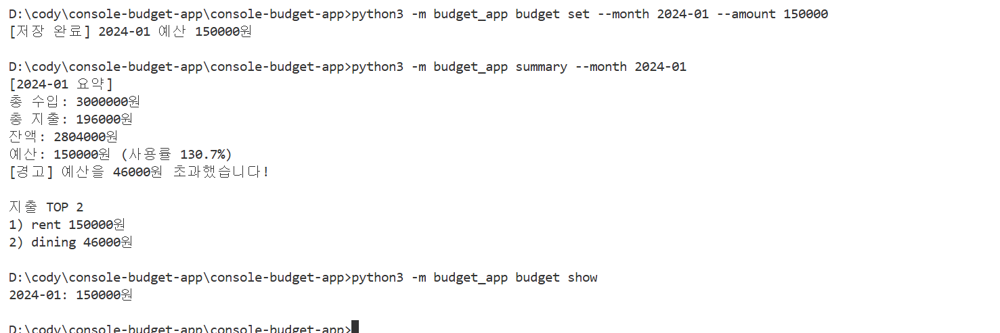
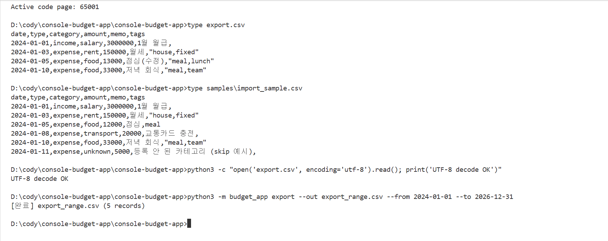
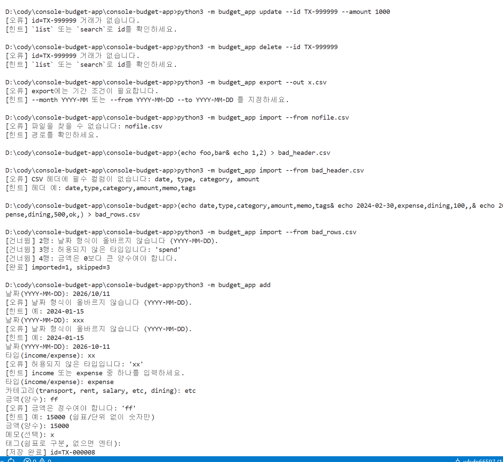
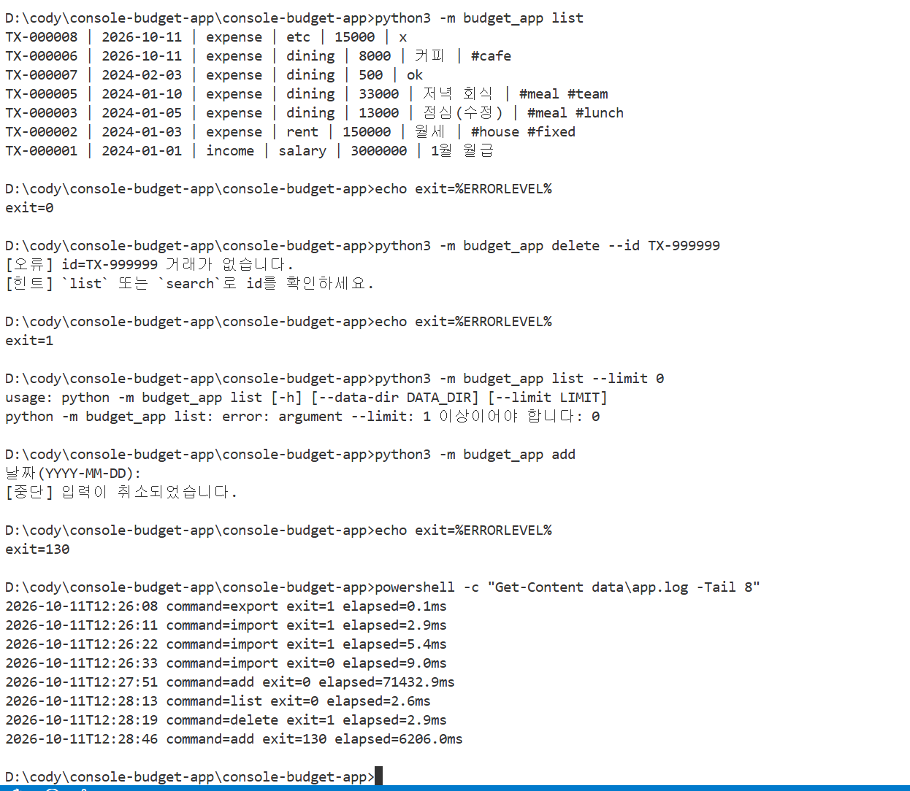

# Windows 실행 증빙 — 평가 항목 1 (세부 1~7)

이 문서는 Windows 명령 프롬프트(cmd)에서 `python3 -m budget_app`을 실제로 실행한 결과를 정리한 것입니다. 저장 폴더(`./data`)가 없는 깨끗한 상태에서 시작했고, 각 캡처 아래에 무엇을 확인했는지와 결과의 의미를 간단히 적었습니다.

← [README로 돌아가기](../README.md)

## 한눈에 보기

| 항목 | 확인 대상 | 결과 |
|---|---|---|
| 1 | add / list / search / update / delete / import / export 동작 | 정상 |
| 2 | 재실행 후 데이터 유지(저장 파일 3개 이상) | 정상 |
| 3 | category add / list / remove, 사용 중 카테고리 처리 | 정상 |
| 4 | budget set 저장, summary 예산 사용률·초과 경고 | 정상 |
| 5 | import/export CSV 스키마(UTF-8, 헤더, 컬럼) | 정상 |
| 6 | 잘못된 입력·파일 → 스택트레이스 없이 오류 + 힌트 | 정상 |
| 7 | 오류 시 0이 아닌 종료 코드, 실행 로그 기록 | 정상 |

## 1. 거래 명령 동작

### 실행한 확인

`import`로 샘플 CSV를 등록하고 `add`로 1건을 대화형 입력했습니다. 이어서 `list`, `search`, `update`, `delete`, `export`를 차례로 실행했습니다.

### 결과 설명

- **import**: 첫 실행이라 저장 폴더와 기본 카테고리가 자동 생성됐습니다. 등록되지 않은 카테고리 `unknown` 행(7행)만 건너뛰어 `imported=5, skipped=1`입니다.
- **add**: 다음 번호 `TX-000006`이 발급됐습니다.
- **list / search**: `list --limit 3`은 최신순 3건만 보여줍니다. `search`는 지정한 조건(카테고리·타입, 기간·키워드·태그)을 **모두** 만족하는 거래만 출력했습니다.
- **update**: TX-000003의 금액·메모·태그만 바뀌었고, 지정하지 않은 필드는 그대로입니다.
- **delete**: TX-000004가 목록에서 사라졌고, 다른 id는 다시 매겨지지 않았습니다.
- **export**: `--month 2024-01`의 결과는 4건입니다. add로 넣은 거래는 날짜가 2026-10-11이라 대상이 아니므로 4건이 맞습니다.

## 2. 재실행 후 데이터 유지

<!-- 저장 파일 목록(dir data) 캡처를 추가한 경우 아래 줄을 함께 사용하세요. -->
<!--  -->

### 실행한 확인

터미널을 닫고 새 창을 연 뒤 `list`를 실행했습니다.

### 결과 설명

1번에서 저장한 5건이 그대로 출력되고, update한 값과 delete 결과도 유지됩니다. 데이터는 `./data`의 `transactions.jsonl`, `categories.jsonl`, `budgets.jsonl`(그리고 실행 로그 `app.log`)에 UTF-8 JSONL로 저장됩니다.

## 3. 카테고리 관리

### 실행한 확인

사용하지 않는 `hobby`를 추가했다가 삭제했습니다. 이어서 사용 중인 `food`를 삭제해 보고, `--replace dining`으로 거래를 옮긴 뒤 삭제했습니다.

### 결과 설명

- `hobby`는 쓰는 거래가 없어 바로 삭제됐습니다.
- `food`는 거래 3건이 사용 중이라 `[오류]`와 함께 거부됐고, `--replace` 사용법이 `[힌트]`로 안내됐습니다.
- `--replace dining`을 지정하자 3건을 `dining`으로 옮긴 뒤 삭제했습니다. `category list`와 `list`에 그대로 반영된 것을 확인했습니다.

## 4. 월 예산과 summary

### 실행한 확인

2024-01 예산을 200,000원으로 저장한 뒤 summary를 실행했습니다. 다음으로 예산을 150,000원으로 다시 저장하고 summary를 다시 실행했습니다.

### 결과 설명

2024-01 총지출은 196,000원입니다.

- 예산 200,000원일 때는 `사용률 98.0%`만 출력됩니다.
- 예산 150,000원일 때는 `사용률 130.7%`와 `[경고] 예산을 46000원 초과했습니다!`가 출력됩니다.
- 같은 달 예산을 다시 저장하면 덮어쓰므로, `budget show`에는 마지막 값 한 줄만 나옵니다.

## 5. CSV 스키마

### 실행한 확인

`chcp 65001`로 UTF-8 코드페이지를 켠 뒤 `type`으로 export 결과와 import 샘플을 출력했습니다. 이어서 Python으로 UTF-8 디코딩을 확인하고, `--from/--to` 조건으로 한 번 더 export했습니다.

### 결과 설명

- 두 파일 모두 헤더가 `date,type,category,amount,memo,tags`로 같습니다. 그래서 export한 파일을 그대로 다시 import할 수 있습니다.
- 태그가 여러 개이면 `"meal,lunch"`처럼 따옴표로 감쌉니다.
- 한글이 깨지지 않고 `UTF-8 decode OK`가 출력됩니다.
- export의 category가 `food`인 이유는, 이 파일을 3번에서 dining으로 바꾸기 **전**에 만들었기 때문입니다.
- `--from/--to` export는 2026년 거래까지 포함해 5건입니다.

## 6. 잘못된 입력과 파일 오류 처리

### 실행한 확인

다음 상황을 각각 실행했습니다.

- 없는 id로 update와 delete
- 기간 조건 없는 export
- 없는 파일, 헤더가 잘못된 CSV, 일부 행이 잘못된 CSV를 import
- add에서 날짜·타입·금액을 일부러 잘못 입력

### 결과 설명

- 모든 오류가 `Traceback` 없이 `[오류] 원인`과 `[힌트] 해결 방법` 두 줄로만 출력됩니다.
- 일부 행이 잘못된 CSV는 2·3·4행(날짜·타입·금액 오류)만 행 번호와 사유를 붙여 건너뛰고, 정상 행은 저장해 `imported=1, skipped=3`입니다.
- add는 잘못 입력할 때마다 같은 질문을 다시 묻고, 올바른 값을 넣으면 이어서 진행해 저장(`TX-000008`)됩니다.

## 7. 오류 상황의 종료 코드와 실행 로그

<!-- list --limit 0 직후 echo exit=%ERRORLEVEL% 캡처를 추가한 경우 아래 줄을 함께 사용하세요. -->
<!--  -->

### 실행한 확인

명령 직후 `echo exit=%ERRORLEVEL%`로 종료 코드를 확인하고, `app.log`의 최근 기록을 조회했습니다. cmd에서는 한 줄에 `&`로 이어 쓰면 이전 값이 찍히므로 명령과 echo를 따로 실행했습니다.

### 결과 설명

- 정상 `list`는 `exit=0`입니다.
- 없는 id로 `delete`하면 `exit=1`입니다.
- `add` 중 Ctrl+C를 누르면 `[중단]` 메시지와 함께 `exit=130`입니다.
- `list --limit 0`은 argparse가 사용법 오류를 출력합니다(종료 코드 2).

즉 오류 상황에서는 종료 코드가 0이 아니고, 오류 종류마다 다른 값을 돌려줍니다. `app.log`에는 모든 명령의 종료 코드와 실행 시간이 남습니다. 예를 들어 `delete exit=1`, `add exit=130`이 기록돼 있습니다. 인자 해석 단계에서 끝난 `list --limit 0`은 명령 핸들러가 실행되지 않아 로그에 없습니다.

## 최종 확인

평가 항목 1의 세부 요구사항 7개를 모두 Windows 명령 프롬프트에서 실제로 실행해 확인했습니다. 구조와 설계 근거(평가 항목 2~4)는 [README의 설계 설명](../README.md#설계-설명-평가-항목-24)에 정리했습니다.
